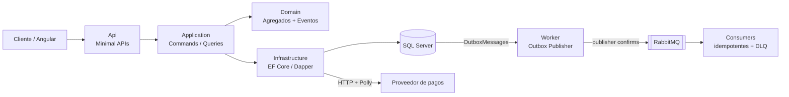

# WalletSystem

Sistema de **billetera virtual y apuestas** (dominio de lotería) construido en **.NET 8** con **Clean Architecture** y **DDD**. El objetivo es resolver los problemas reales de un sistema transaccional de alta demanda: **consistencia, idempotencia, resiliencia ante fallas de un proveedor de pagos externo y entrega confiable de eventos**.

> Proyecto de práctica / portfolio. El foco no es la cantidad de features, sino las decisiones de arquitectura y por qué se tomaron.

---

## Estado del proyecto

| Capa | Estado | Qué incluye |
|---|---|---|
| Domain | ✅ Completo | Agregados `Wallet` y `Bet`, Value Objects, Domain Events, 26 tests sin mocks |
| Application | ✅ Completo | 6 Commands, 3 Queries, pipeline de validación, tests de handlers |
| Infrastructure | ✅ Completo | EF Core, Dapper, Outbox, cliente del proveedor de pagos con Polly |
| Worker (publisher) | ✅ Completo | Publica el Outbox a RabbitMQ con publisher confirms |
| Worker (consumer + DLQ + reconciliación) | 🔲 Pendiente | Consumer idempotente, dead-letter queue, job de depósitos `Pending` |
| Api (Minimal APIs) | 🔲 Pendiente | Endpoints, manejo de errores, rate limiting, health checks |
| Frontend Angular | 🔲 Pendiente | Dashboard en tiempo real con SignalR |
| Tests de integración | 🔲 Pendiente | Testcontainers contra SQL Server real |

---

## Arquitectura



### Capas y dependencias

```
Domain  ←  Application  ←  Infrastructure  ←  Api / Worker
```

Las dependencias apuntan siempre hacia adentro. `Domain` no conoce a nadie y se testea sin mocks.

```
WalletSystem/
├── WalletSystem.Domain/            Agregados, Value Objects, Domain Events
├── WalletSystem.Application/       Commands, Queries, interfaces, validaciones
├── WalletSystem.Infrastructure/    Persistencia, Outbox, proveedor de pagos
├── WalletSystem.Worker/            Publisher del Outbox hacia RabbitMQ
├── tests/
│   └── WalletSystems.UnitTest/     Tests de Domain y de handlers
├── tools/
│   └── WalletSystem.FakePaymentProvider/   Mock del proveedor de pagos (solo desarrollo)
├── docker-compose.yml              SQL Server 2022 + RabbitMQ
└── .env.example                    Plantilla de credenciales locales
```

---

## Decisiones de diseño

### 1. Depósito en dos fases
Un depósito depende de un proveedor externo, así que el dominio no puede asumir que sale bien al instante.

1. `RequestDeposit` crea una transacción `Pending` **sin tocar el saldo** y levanta `WalletDepositRequestedEvent`.
2. `CompleteDeposit` acredita el saldo o `FailDeposit` marca el fallo.

Retiros, apuestas, premios y reembolsos son síncronos porque no dependen de terceros.

### 2. Idempotencia en todas las operaciones de dinero
Cada operación lleva una `IdempotencyKey`. Reintentar el mismo request no duplica el movimiento: el agregado busca la clave en sus transacciones y, si existe, devuelve el resultado anterior **sin volver a aplicar el cambio ni levantar el evento**. La base lo refuerza con índices únicos `(WalletId, IdempotencyKey)`.

### 3. Resultado indeterminado del proveedor de pagos
Si el proveedor hace timeout, devuelve 5xx o el circuito está abierto, **no se sabe** si el cobro se procesó. En ese caso el depósito queda `Pending` (no se marca como fallido) para que un job de reconciliación consulte el estado real. Marcarlo como fallido podría dejar un cobro hecho sin acreditar.

La política de resiliencia (Polly) se compone así:

```
Retry (3x, backoff exponencial + jitter, solo 5xx/timeouts)
  → Circuit Breaker (5 fallos, 30 s abierto)
    → Bulkhead (10 paralelos, 20 en cola)
      → Timeout (5 s)
```

Las respuestas 4xx **no** se reintentan. La política se registra como Singleton para que el circuit breaker conserve su estado.

### 4. Outbox Pattern
El problema: guardar en la base y publicar a RabbitMQ no puede ser una sola transacción (*dual write problem*).

La solución: un `SaveChangesInterceptor` de EF Core serializa los Domain Events a la tabla `OutboxMessages` **en la misma transacción** que el cambio de negocio. Un proceso aparte (el Worker) los publica después.

```
┌─ Transacción SQL (atómica) ───┐        ┌─ Worker ─────────────────────┐
│ UPDATE Wallets                │        │ SELECT ... ProcessedAt NULL  │
│ INSERT Bets                   │        │ → publica a RabbitMQ         │
│ INSERT OutboxMessages ────────┼───────▶│ → marca ProcessedAt          │
└───────────────────────────────┘        └──────────────────────────────┘
```

Garantía: **at-least-once**. Un evento nunca se pierde, pero puede duplicarse si el Worker cae entre el ack del broker y el `UPDATE`. Por eso los consumers deben ser idempotentes (el `MessageId` viaja con cada mensaje).

Detalles del publisher:
- `UPDLOCK, READPAST`: varias instancias del Worker no toman las mismas filas.
- Publisher confirms con **una confirmación por lote**, para mayor throughput.
- Si el broker está caído, los mensajes quedan pendientes y se registra el error en la columna `Error`. Al volver RabbitMQ salen solos.
- Índice filtrado `WHERE ProcessedAt IS NULL` para que la consulta se mantenga barata aunque la tabla crezca.

### 5. CQRS liviano
- **Commands** pasan por el dominio y EF Core (consistencia, reglas de negocio).
- **Queries** leen directo con **Dapper** sobre SQL optimizado, sin cargar agregados.

### 6. Concurrencia optimista
`Wallet` y `Bet` tienen `RowVersion`. Dos operaciones simultáneas sobre la misma billetera no pisan el saldo: una falla con `DbUpdateConcurrencyException` y se reintenta.

---

## Modelo de dominio

**Wallet** (Aggregate Root): saldo y lista de `WalletTransaction`.

| Operación | Tipo | Efecto |
|---|---|---|
| `RequestDeposit` / `CompleteDeposit` / `FailDeposit` | Dos fases | Depósito vía proveedor externo |
| `Withdraw` | Síncrona | Retiro |
| `DebitForBet` | Síncrona | Descuenta la apuesta |
| `CreditPrize` | Síncrona | Acredita premio |
| `RefundBet` | Síncrona | Devuelve el stake de una apuesta cancelada |

**Bet** (Aggregate Root): referencia a la wallet solo por `WalletId`. Estados: `Placed → Won / Lost / Cancelled`. Usa el Value Object `Odds` (rango 1.01–1000) para calcular el premio.

**Value Objects:** `Money`, `Odds`. **Eventos:** `WalletDepositRequested`, `WalletTransactionCompleted`, `WalletTransactionFailed`, `BetPlaced`, `BetSettled`, `BetCancelled`.

---

## Stack

| Área | Tecnología |
|---|---|
| Runtime | .NET 8, C# |
| Mensajería | RabbitMQ 3.13 (`RabbitMQ.Client` 6.8) |
| Persistencia | SQL Server 2022, EF Core 8 (escrituras), Dapper (lecturas) |
| CQRS | MediatR 12 |
| Validación | FluentValidation |
| Resiliencia | Polly 8 |
| Tests | xUnit, NSubstitute |
| Infra local | Docker Compose |

---

## Cómo correrlo

### Requisitos
- .NET 8 SDK (o superior)
- Docker Desktop
- `dotnet-ef`: `dotnet tool install --global dotnet-ef`

### 1. Levantar SQL Server y RabbitMQ

```bash
cp .env.example .env
docker compose up -d
docker compose ps        # esperar a que ambos digan "healthy"
```

| Servicio | Dirección |
|---|---|
| SQL Server | `localhost,1433` (usuario `sa`) |
| RabbitMQ AMQP | `localhost:5672` |
| RabbitMQ UI | http://localhost:15672 |

Las credenciales salen del `.env` (que no se sube al repo).

### 2. Crear la base de datos

```bash
export WALLET_DB_CONNECTION='Server=localhost,1433;Database=WalletDb;User Id=sa;Password=<SA_PASSWORD del .env>;TrustServerCertificate=True'

dotnet ef database update \
  --project WalletSystem.Infrastructure \
  --startup-project WalletSystem.Infrastructure
```

Esto crea la base `WalletDb` con las tablas `Wallets`, `WalletTransactions`, `Bets` y `OutboxMessages`.

### 3. Configurar y correr el Worker

Los secretos se guardan con `user-secrets`, fuera del repo:

```bash
dotnet user-secrets set "ConnectionStrings:WalletDb" "Server=localhost,1433;Database=WalletDb;User Id=sa;Password=<SA_PASSWORD>;TrustServerCertificate=True" --project WalletSystem.Worker
dotnet user-secrets set "RabbitMq:Password" "<RABBITMQ_PASSWORD del .env>" --project WalletSystem.Worker

dotnet run --project WalletSystem.Worker
```

### 4. Probar el Outbox de punta a punta

Con el Worker corriendo, insertá un mensaje de prueba:

```sql
INSERT INTO WalletDb.dbo.OutboxMessages (Id, Type, Payload, OccurredAt, ProcessedAt, Error)
VALUES (NEWID(), 'WalletSystem.Domain.Wallets.Events.WalletDepositRequestedEvent',
        '{"test":true}', SYSUTCDATETIME(), NULL, NULL);
```

El Worker loguea `Publicados 1 mensajes del Outbox`, la fila queda con `ProcessedAt` y el mensaje aparece en la cola `wallet.events.debug` de RabbitMQ.

**Prueba de resiliencia:** con `docker compose stop rabbitmq` insertá otra fila. El Worker registra el error y deja el mensaje pendiente. Al hacer `docker compose start rabbitmq`, el mensaje se publica solo, sin pérdida.

### 5. Tests

```bash
dotnet test
```

### Simular fallas del proveedor de pagos

`tools/WalletSystem.FakePaymentProvider` es un mock HTTP independiente (ningún proyecto lo referencia):

```bash
dotnet run --project tools/WalletSystem.FakePaymentProvider
```

| Endpoint | Función |
|---|---|
| `POST /charges` | Procesa un cobro, idempotente por header `Idempotency-Key` |
| `GET /charges/{key}` | Consulta el estado de un cobro |
| `POST /admin/chaos` | Configura `ErrorRate`, `ResponseLossRate`, `SlowRate` |

Casos que simula: error 503 antes de procesar, timeout (7 s, mayor al timeout de 5 s del cliente), y **cobro procesado con respuesta perdida**, que es el escenario difícil que fuerza el estado indeterminado. Los montos mayores a 100.000 se rechazan con 402.

---

## Roadmap

- [x] Domain: agregados, Value Objects, Domain Events y tests
- [x] Application: Commands, Queries, validación y tests de handlers
- [x] Infrastructure: persistencia, Outbox, read services, proveedor con Polly
- [x] Worker: publisher del Outbox con publisher confirms
- [ ] Worker: consumer idempotente con DLQ
- [ ] Worker: job de reconciliación de depósitos `Pending`
- [ ] Api: Minimal APIs, manejo de excepciones, rate limiting, health checks
- [ ] Angular: dashboard en tiempo real con SignalR
- [ ] Tests de integración con Testcontainers

---

## Autor

**Jorge Aníbal Rodríguez** · Desarrollador Fullstack .NET · Posadas, Misiones, Argentina
GitHub: [rzjan](https://github.com/rzjan)
